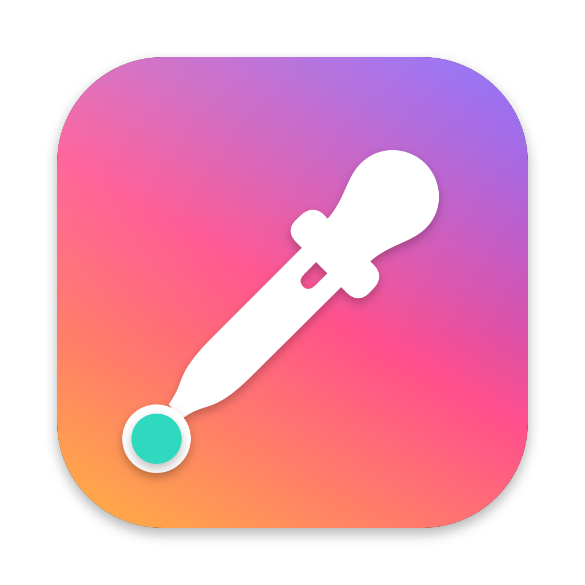
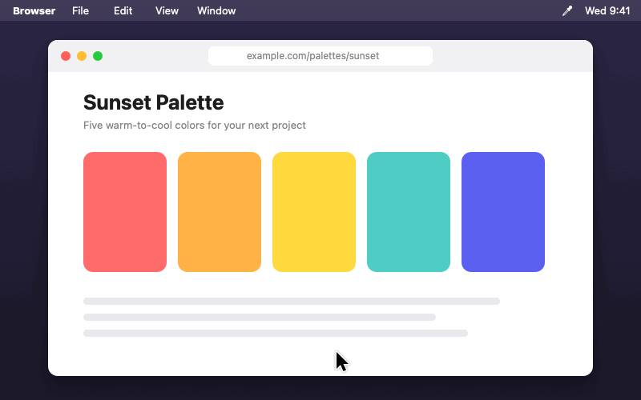

<p align="center">
  
</p>

<h1 align="center">Machoot</h1>

<p align="center">
  A tiny, open-source macOS menu bar color picker.<br>
  Hover over anything — a website, a design file, an app — press a shortcut, and the color under your cursor is copied to the clipboard.
</p>

<p align="center">
  <a href="../../releases/latest"></a>
  
  <a href="LICENSE"></a>
</p>

<p align="center">
  
</p>

> 🇹🇷 Ekranda herhangi bir yerin üzerine gelip kısayola bastığınızda, imlecin altındaki rengin kodunu panoya kopyalayan küçük bir macOS menü çubuğu uygulaması.

## Features

- **Instant pick** — `⌃⌥C` copies the color right under the cursor, no clicking.
- **Magnifier pick** — `⌃⌥X` opens the system loupe for pixel-precise picking (no permission needed).
- **Customizable shortcuts** — record your own in Settings.
- **Formats** — `#1A2B3C`, `1A2B3C`, `rgb(26, 43, 60)`, `hsl(210, 40%, 17%)`, SwiftUI `Color(...)`.
- **History** — the last 12 colors in the menu bar; click one to copy it again.
- Floating preview next to the cursor, optional sound, launch at login.
- Native Swift/AppKit, no dependencies, ~1 MB.

Colors are converted to **sRGB**, so values match what you'd use in CSS.

## Requirements

macOS 15.2 or later (Apple Silicon or Intel).

## Install

### Homebrew (recommended)

```sh
brew install --cask metinyildirimnet/tap/machoot
```

Update with `brew upgrade --cask machoot`, remove with `brew uninstall --cask machoot`.

### Manual

1. Download `Machoot.zip` from [Releases](../../releases) and move `Machoot.app` to `/Applications`.
2. The app is not notarized, so on first launch macOS will block it. Open **System Settings → Privacy & Security** and click **Open Anyway**, or run:
   ```sh
   xattr -dr com.apple.quarantine /Applications/Machoot.app
   ```

### Permission

On first instant pick, grant **Screen & System Audio Recording** permission (System Settings → Privacy & Security). This is required by macOS to read screen pixels. Machoot only ever captures the single pixel under your cursor and never stores or sends it anywhere.

## Usage

Machoot lives in the **menu bar** (the eyedropper icon, top right) — it has no Dock icon or main window.

| Action | How |
| --- | --- |
| Copy the color under the cursor | `⌃⌥C` (Control + Option + C) |
| Pick with the magnifier | `⌃⌥X`, then click |
| Recent colors, copy format, settings | Click the menu bar icon |
| Open Settings | Open Machoot again while it's running (Spotlight or Finder) |
| Start automatically | Settings → **Launch at login** |
| Reopen after quitting | `⌘ Space` → type **Machoot** → Enter, or open it from **Applications** |

## Build from source

```sh
git clone https://github.com/metinyildirimnet/machoot.git
cd machoot
./scripts/build-app.sh          # → build/Machoot.app and build/Machoot.zip
open build/Machoot.app
```

Options: `ARCHS=arm64 ./scripts/build-app.sh` for a single-arch build, `SIGN_IDENTITY="Developer ID Application: …"` to sign with your certificate.

For quick iteration: `swift run` (hotkeys work, but launch at login requires the bundled `.app`).

> **Note:** With ad-hoc signing, macOS ties the Screen Recording permission to the exact build. After rebuilding, you may need to remove and re-add Machoot in the permission list.

## Project layout

| File | Purpose |
| --- | --- |
| `AppDelegate.swift` | Menu bar item, menu, picking flow |
| `HotKeyManager.swift` | Global hotkeys (Carbon `RegisterEventHotKey`, no Accessibility permission) |
| `ScreenSampler.swift` | Reads the pixel under the cursor via ScreenCaptureKit |
| `Shortcut.swift` | Shortcut model and keyboard-layout-aware display names |
| `RGBColor.swift` | Color model and output formats |
| `Preferences.swift` | Settings and history (UserDefaults) |
| `SettingsView.swift` | SwiftUI settings window and shortcut recorder |
| `HUDWindow.swift` | Floating preview near the cursor |

Regenerate assets: `swift scripts/make-icon.swift` (app icon) and `swift scripts/make-demo.swift` (`docs/demo.gif`).

## Releasing

Push a tag like `v0.2.0`. GitHub Actions builds the app, attaches `Machoot.zip` to the release, and updates the cask in [metinyildirimnet/homebrew-tap](https://github.com/metinyildirimnet/homebrew-tap) (requires a `HOMEBREW_TAP_TOKEN` repo secret with write access to the tap). The cask template lives in [`homebrew/machoot.rb`](homebrew/machoot.rb).

## Contributing

Issues and pull requests are welcome. Ideas: more formats (OKLCH, Tailwind nearest), contrast checker, palette export.

## Author

Developed by **Metin YILDIRIM** ([@cimendijital](https://instagram.com/cimendijital)).

## License

[MIT](LICENSE) © 2026 Metin YILDIRIM
